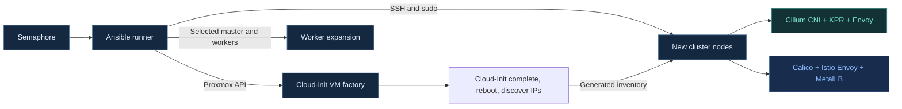

# Proxmox Kubernetes Homelab with Ansible

Automate a self-hosted Kubernetes homelab on Proxmox VE with **Ansible and Semaphore**. A cluster init run creates its VMs, waits for Cloud-Init, restarts them, discovers their final DHCP addresses, and bootstraps Kubernetes.

[Quick start](#quick-start) · [Infrastructure](#infrastructure) · [Playbooks](#playbooks) · [Detailed guide](ansible/README.md) · [Contributing](CONTRIBUTING.md)

## Infrastructure

Each cluster starts with **1 control plane + at least 4 workers**, running **CRI-O**. Choose a stack:

| | Cilium stack | Istio stack |
|---|---|---|
| Pod networking | Cilium CNI | Calico VXLAN |
| Service proxy | Cilium kube-proxy replacement | kube-proxy iptables |
| Envoy Gateway | Cilium Gateway API | Istio Gateway API |
| LoadBalancer IPs | Cilium LB IPAM | MetalLB IPAddressPool |
| LAN advertisement | Cilium L2 announcements | MetalLB L2Advertisement |

Worker interfaces are detected automatically from their route to the master. Different NIC names across nodes are supported. Additional workers inherit the runtime and CNI configuration recorded on their selected master.

## Quick start

1. **Prepare Semaphore.** Configure `PROXMOX_VE_ENDPOINT` and secret `PROXMOX_VE_API_TOKEN`. Mount the persistent key store at `/var/lib/homelab/vm-keys`, mode `0700`, containing `.persistent-key-store`. The runner needs Python 3 and `ssh-keygen`; the factory uses the Proxmox REST API without additional Python packages or Ansible collections.
2. **Select runner inventory.** Use [runner-local.yml](ansible/inventory/runner-local.yml), or a static inventory containing only `localhost` with `ansible_connection: local`. Remove the placeholder node inventory from the init template. Keep parallel tasks, Dry Run, and Limit disabled.
3. **Run Cluster Factory.** Select `ansible/playbooks/cluster-cilium.yml` or `cluster-istio.yml`. Set `cluster_name=dev` and `worker_count=9` for 1 master + 9 workers per stack. Set `node_lan_cidr` and the LB range to match your LAN. The factory allocates unused VMIDs and generates `dev-cilium-master-1`, `dev-cilium-worker-1` through `9` (or `dev-istio-*`). No per-node IP input is needed.
4. **Expand later.** `add-workers.yml` still joins existing, inventoried VMs; it does not provision extra VMs. Start with the generated inventory, add the new worker VM details, and select `master` and `workers`. See the [Ansible guide](ansible/README.md).

## Playbooks

| Semaphore task | Playbook | Inventory | Run parameters |
|---|---|---|---|
| Init Cilium + VMs | [cluster-cilium.yml](ansible/playbooks/cluster-cilium.yml) | [runner-local.yml](ansible/inventory/runner-local.yml) | `cluster_name`, `worker_count`, LAN/LB settings, optional `gateway_hostname` |
| Init Istio + VMs | [cluster-istio.yml](ansible/playbooks/cluster-istio.yml) | [runner-local.yml](ansible/inventory/runner-local.yml) | `cluster_name`, `worker_count`, LAN/LB settings, optional `gateway_hostname` |
| Add workers | [add-workers.yml](ansible/playbooks/add-workers.yml) | Target master and new workers | `master`, `workers` |

Pass run parameters as **Extra variables**. Proxmox credentials use **Environment variables**. Guest access uses generated SSH keys; the integrated factory does not require a guest password. `master` is an inventory hostname. Init and worker expansion have separate forms; no `cluster_operation` is needed.

<strong>Lab defaults and prerequisites</strong>

| Setting | Default |
|---|---|
| Proxmox template / storage | `9201` / `nvme` |
| VM bridge / guest user | `vmbr1` / `debian` |
| Node networking | DHCP with stable reservations |
| Node LAN | `192.168.10.0/24` |
| LoadBalancer pool | `192.168.10.10–192.168.10.20`, outside DHCP |
| Worker L2 interfaces | Automatic (`l2_interfaces: []`) |

The bridge and DHCP server must already exist. The golden template must have Debian 12+ or Ubuntu 24.04+, kernel 6.1+, Python 3, Cloud-Init, iproute2, enabled QEMU Guest Agent, and passwordless sudo for the Cloud-Init user. Use separate, non-overlapping LB pools for concurrent clusters. See [VM defaults](ansible/roles/homelab_factory/defaults/main.yml) and the [Ansible guide](ansible/README.md).

## Validation and scope

GitHub Actions checks cluster playbook syntax, preflight behavior, and the VM lifecycle using a fake Proxmox API. It does not connect to Proxmox or deploy infrastructure. See [local validation commands](CONTRIBUTING.md).

Gateways initially expose **HTTP on port 80**; add an `HTTPRoute` for applications. DNS and HTTPS are configured separately. This project currently supports a single control plane per cluster; HA, upgrades, and cross-CNI migrations are outside the current flow.
