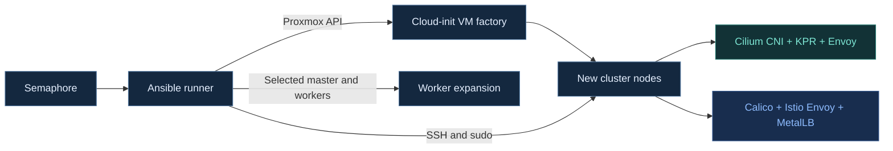

# Proxmox Kubernetes Homelab with Ansible

Automate a self-hosted Kubernetes homelab on Proxmox VE with **Ansible and Semaphore**. Create cloud-init VMs, bootstrap a Cilium or Istio cluster, and add workers through separate, focused playbooks.

[Quick start](#quick-start) · [Infrastructure](#infrastructure) · [Playbooks](#playbooks) · [Detailed guide](ansible/README.md) · [Contributing](CONTRIBUTING.md)

## Infrastructure

Each cluster starts with **1 control plane + at least 4 workers**, running **CRI-O**. Choose a stack:

| | Cilium stack | Istio stack |
|---|---|---|
| Pod networking | Cilium CNI | Calico VXLAN |
| Service proxy | Cilium kube-proxy replacement | kube-proxy iptables |
| Envoy Gateway | Cilium Gateway API | Istio Gateway API |
| LoadBalancer IPs | Cilium LB IPAM | MetalLB IPAddressPool |
| LAN advertisement | Cilium L2 announcements | MetalLB L2Advertisement |

Worker interfaces are detected automatically from their route to the master. Different NIC names across nodes are supported. Additional workers inherit the runtime and CNI configuration recorded on their selected master.

## Quick start

1. **Prepare Semaphore.** Create Ansible Playbook templates from this repository; use `ansible` as the working directory when available. Configure `PROXMOX_VE_ENDPOINT` and secret `PROXMOX_VE_API_TOKEN` for the VM factory. Mount its persistent key store at `/var/lib/homelab/vm-keys`.
2. **Create the VMs.** Run the factory, then add each host's `ansible_host` and `vm_id` to the [Cilium](ansible/inventory/cilium.yml) or [Istio](ansible/inventory/istio.yml) inventory. Verify SSH/sudo access and trusted SSH host keys. Reserve DHCP leases so node addresses stay stable.
3. **Bootstrap a cluster.** Review [cluster settings](ansible/inventory/group_vars/all.yml), choose an init playbook, and set `worker_count=4`. Optionally set `gateway_hostname=app.example.com`.
4. **Expand when needed.** Create more VMs, update inventory, and run **Add workers** with `master=master-1` and `workers=worker-5,worker-6`.

## Playbooks

| Semaphore task | Playbook | Inventory | Run parameters |
|---|---|---|---|
| Create VM | [create-vm.yml](ansible/playbooks/create-vm.yml) | [runner.yml](ansible/inventory/runner.yml) | `vm_name`, `vm_id`, `vm_password`; resource defaults included |
| Init Cilium | [cluster-cilium.yml](ansible/playbooks/cluster-cilium.yml) | [cilium.yml](ansible/inventory/cilium.yml) | `worker_count`, optional `gateway_hostname` |
| Init Istio | [cluster-istio.yml](ansible/playbooks/cluster-istio.yml) | [istio.yml](ansible/inventory/istio.yml) | `worker_count`, optional `gateway_hostname` |
| Add workers | [add-workers.yml](ansible/playbooks/add-workers.yml) | Target master and new workers | `master`, `workers` |

Pass run parameters as **Extra variables**, except secret `vm_password`, which uses an **Environment variable**. `master` is an inventory hostname. Init and worker expansion have separate forms; no `cluster_operation` is needed.

<strong>Lab defaults and prerequisites</strong>

| Setting | Default |
|---|---|
| Proxmox template / storage | `9201` / `nvme` |
| VM bridge / guest user | `vmbr1` / `debian` |
| Node networking | DHCP with stable reservations |
| Node LAN | `192.168.10.0/24` |
| LoadBalancer pool | `192.168.10.10–192.168.10.20`, outside DHCP |
| Worker L2 interfaces | Automatic (`l2_interfaces: []`) |

Use separate VMs and non-overlapping LoadBalancer pools for concurrent clusters. Guests need Debian 12+ or Ubuntu 24.04+, kernel 6.1+, Python 3, cloud-init, iproute2, and working SSH/sudo access. See [VM defaults](ansible/vars/vm-factory.yml) and the [Ansible guide](ansible/README.md).

## Validation and scope

GitHub Actions checks cluster playbook syntax and runs local tests with temporary inventories. It does not connect to Proxmox or deploy infrastructure. See [local validation commands](CONTRIBUTING.md).

Gateways initially expose **HTTP on port 80**; add an `HTTPRoute` for applications. DNS and HTTPS are configured separately. This project currently supports a single control plane per cluster; HA, upgrades, and cross-CNI migrations are outside the current flow.
